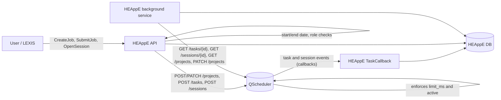
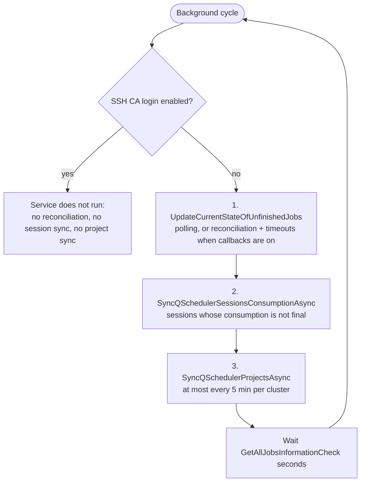
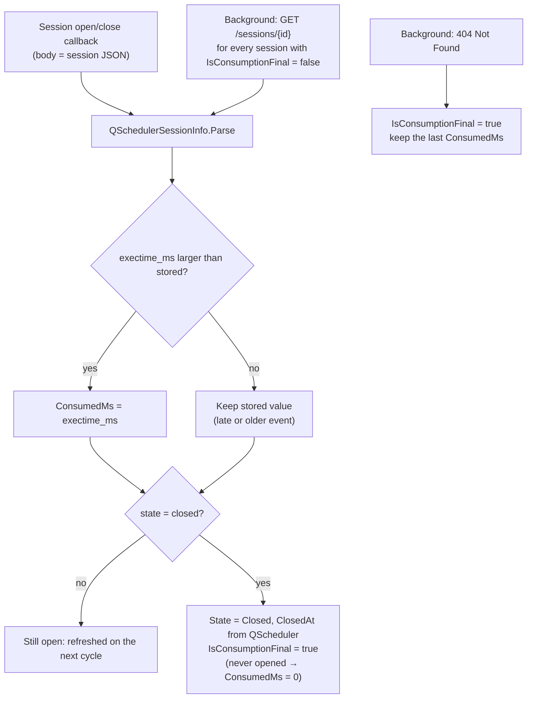
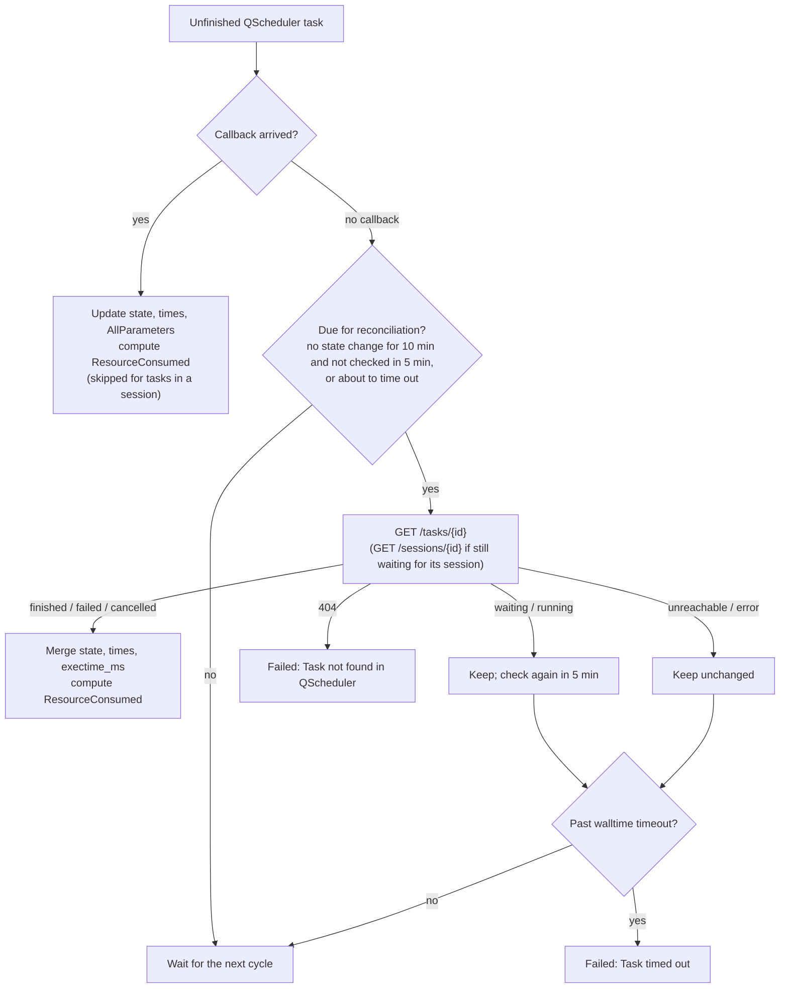
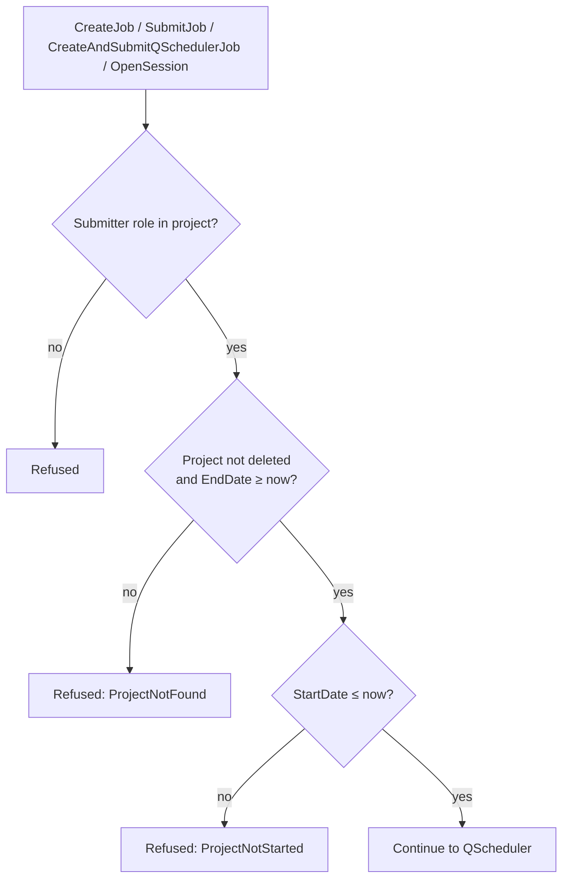

# QScheduler: accounting, limits and synchronization

How HEAppE accounts QScheduler usage and keeps QScheduler projects in line with HEAppE.
HEAppE is the source of truth for project limits and validity. QScheduler enforces them.

> [!WARNING]
> **The QScheduler limit is the sum of ALL the project's allocations, including non-quantum ones.**
> HEAppE sends `limit_ms = sum(AllocationAmount) × 1000` over every `ProjectClusterNodeTypeAggregation`
> of the project. It does not check which node type aggregation an allocation belongs to.
> If a QPU project also has, for example, a CPU allocation of 10 000 core hours, QScheduler gets
> 10 000 extra QPU seconds. If one HEAppE has several QScheduler clusters, each of them gets the full sum.
> **Keep only quantum (QPU seconds) allocations on projects used with QScheduler.**

> [!WARNING]
> **The background synchronization does not run when SSH certificate authority login is enabled.**
> The project sync, the session consumption sync and the lost-callback check all run inside the
> `UpdateUnfinishedJobsBackgroundService`. That service exits immediately when
> `SshCaSettings.UseCertificateAuthorityForAuthentication` is `true`. In that setup:
> - limits and active flags are sent to QScheduler only when a job is submitted or a session opened,
>   so expired projects stay active in QScheduler and values changed by other clients are not corrected;
> - session consumption is filled only from callbacks; a lost or disabled callback leaves it empty;
> - tasks whose final callback was lost are failed by the walltime timeout and their consumption is not recorded.

## Configuration

Cluster `CustomConfiguration`:

| Key | Meaning |
|---|---|
| `QSchedulerProjectPrefix` | Prefix of this instance's QScheduler project names (`<prefix>.<AccountingString>`). Falls back to `QSchedulerNotifier`, then `InstanceIdentifierPath`. Must not contain `.`, must never change. |
| `EnableCallback` | Use QScheduler notifications instead of polling. |
| `QSchedulerNotifier` | Notifier name registered in QScheduler. |

Accounting: create an `Accounting` with the formula `exectime_ms/1000` (QPU seconds) and link it to the
QScheduler node type aggregation. The project's `UsageType` must be `QPUSeconds`.

## What is accounted

| What | Stored on | Billed |
|---|---|---|
| Task submitted directly to a project | `SubmittedTaskInfo.AllocatedTime` (s) and `ResourceConsumed` (formula) | Yes |
| QScheduler session | `QSchedulerSession.ConsumedMs` (whole open time) | Yes |
| Task inside a session | `SubmittedTaskInfo.AllocatedTime` (s) only | No, the session is billed |

Project reports include sessions (`QSchedulerSessions`, `QSchedulerSessionsUsage`) in the total usage.

## Synchronization with QScheduler

| What | When |
|---|---|
| Project limit and `active` | On submit / session open, and every 5 minutes per cluster by the background sync |
| Session consumption | On session callbacks, and on every background cycle for sessions that are not final |
| Task state and consumption (callbacks on) | On task callbacks; tasks without a state change for 10 minutes, or about to time out, are queried directly |

QScheduler never asks HEAppE for anything. It enforces the `limit_ms` and `active` values it was last
given and only sends notifications (callbacks). HEAppE therefore has to push every change.

### Overview

### Background cycle

All periodic synchronization runs in `UpdateUnfinishedJobsBackgroundService`, every
`GetAllJobsInformationCheck` seconds. Each step has its own error handling, so one failing step does not
stop the others.

### Project limit and active flag

```mermaid
flowchart TD
    subgraph Submit["On submit / session open"]
        S1["EnsureProjectRegisteredAsync"] --> S2["limit_ms = sum of allocations × 1000"]
        S2 --> S3{"Same value already sent<br/>by this process?"}
        S3 -->|yes| S4["Nothing sent"]
        S3 -->|no| S5["POST /projects {name, limit_ms, active: true}"]
        S5 --> S6{"409 Conflict?"}
        S6 -->|yes| S7["PATCH /projects/{name} {limit_ms, active: true}"]
        S6 -->|no| S8["Created"]
    end

    subgraph Sync["Background project sync (every 5 min per cluster)"]
        P1["HEAppE: QPU projects of the cluster"] --> P2{"Any project to connect with?"}
        P2 -->|no| P3["Skip cluster"]
        P2 -->|yes| P4["GET /projects"]
        P4 --> P5["Keep names starting with this instance's prefix"]
        P5 --> P6{"Project still in HEAppE?"}
        P6 -->|no| P7["PATCH active: false"]
        P6 -->|yes| P8["desired limit = sum of allocations × 1000<br/>desired active = StartDate ≤ now ≤ EndDate"]
        P8 --> P9{"Differs from QScheduler?"}
        P9 -->|no| P10["Nothing to do"]
        P9 -->|yes| P11["PATCH only the changed fields<br/>(overwrites values set by other clients)"]
    end
```

The submit path only runs for projects that passed HEAppE's start/end date check, so it always sends
`active: true`. The background sync is what deactivates expired, not yet started and removed projects.

### Session consumption

QScheduler charges a session's whole open time to the project. HEAppE stores it on `QSchedulerSession`
from two sources:

Tasks inside a session keep their own `exectime_ms` as `AllocatedTime`, for information only; they get no
`ResourceConsumed`.

### Task state and consumption (callbacks enabled)

With callbacks disabled, every unfinished task is polled each cycle (`GET /tasks/{id}`) and merged the
same way.

### Validity checks in HEAppE

HEAppE itself refuses creating jobs, submitting and opening sessions outside the project's start and end
date:

> [!NOTE]
> The sync connects to QScheduler through one of the cluster's QPU projects. If the cluster has no
> QPU project left in HEAppE (for example the last one was deleted), the sync skips the cluster and the
> deleted project stays active in QScheduler. HEAppE still refuses work in it.

## Several HEAppE instances on one QScheduler

Each instance uses its own prefix, so limits and consumption never mix. Sessions are accepted only if this
instance tracks them and QScheduler reports them for the same prefixed project. QScheduler has no
per-client authentication, so this isolation is by convention, not access control.

Existing unprefixed projects are renamed once with the scripts in
[`QSchedulerScripts/ProjectPrefixMigration`](../../../QSchedulerScripts/ProjectPrefixMigration/README.md).
